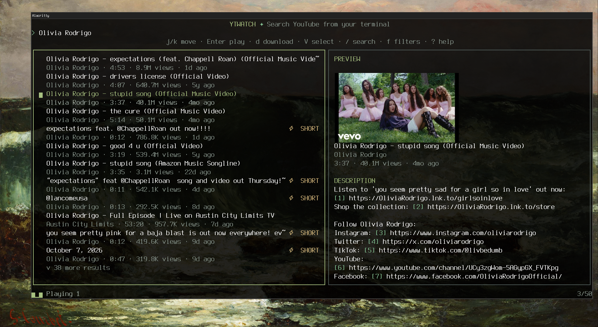

<div align="center">


Search YouTube from your terminal. Watch on purpose.

[](https://go.dev)
[](LICENSE)
[](#install)



</div>

## Why

ytwatch is for finding a video, watching it, and leaving. There is no home
page, no recommendations, no account, no comments and no likes. It does not
manage subscriptions either: an RSS reader such as
[Newsraft](https://codeberg.org/newsraft/newsraft) already does that well, and
ytwatch fills the gap it leaves, which is finding new, ordinary content on
purpose. (The idea comes from Newsraft.) Want the comments? Press `o` to open
the video, or `3o` for a link in its description, in your browser.

It also stays light: [yt-dlp](https://github.com/yt-dlp/yt-dlp) searches,
[mpv](https://mpv.io) plays, and no browser runs.

## Features

- **One search for everything:** videos, Shorts, live streams and playlists,
  with filters for type, duration and date, and a language and region of
  your choice.
- **Thumbnails** beside every result. They use `ueberzugpp`, which works the
  same on Wayland, X11 and in terminals like Alacritty and foot that have no
  image protocol of their own.
- **Full live stream support.** Live streams are marked, and their chat opens
  next to the video. Past live streams are marked too, so you can tell a
  recording (VOD) from a normal upload, which YouTube itself does not show.
- **Playlists:** `Enter` plays the whole playlist, `B` opens it to pick videos.
- **Queue and download:** select several results with `V`, then play them in one
  mpv or download them. Choose the quality, or audio only.
- **Window placement:** mpv and chat windows go to the workspace you choose on
  sway, i3, Hyprland, niri, bspwm and other X11 window managers.
- **Made for Vim users:** `hjkl`, `gg`, `G`, counts like `5j`, `Ctrl+d`, and `V`
  for line selection.
- **Share a video** by yanking its link with `y`.
- **Rice-friendly:** 8 color themes, any color can be changed, and the
  `terminal` theme follows your terminal palette (pywal and similar tools).
- **Undo a mistake:** `u` (or `Esc`) cancels the last play or download for
  10 seconds.
- **Tidy by default:** history and thumbnails are cached for speed, then deleted
  (30 days and 7 days) so they never grow without limit.

## Install

Requires Go 1.23+, `yt-dlp`, `mpv`, `ffmpeg`, `ueberzugpp`, a web browser,
`wl-clipboard` (Wayland) or `xclip` / `xsel` (X11), and `wmctrl` (X11 window
managers other than i3). On Arch Linux:

```sh
sudo pacman -S go yt-dlp mpv ffmpeg ueberzugpp wl-clipboard
git clone https://github.com/geovannewashington/ytwatch.git
cd ytwatch && make install    # copies ytwatch to ~/.local/bin
```

Keep `yt-dlp` up to date, because YouTube changes often. On Debian and Ubuntu the
packaged version is too old: use `pipx install yt-dlp`. Run `ytwatch doctor` to
check what is installed and what your session supports.

## Usage

```sh
ytwatch                  # opens with the search line active
ytwatch "Go interfaces"  # opens with a search
```

mpv keeps playing if you quit ytwatch. Press `?` for help.

| Key | Action |
|---|---|
| `/` `r` | Edit the search (`Up` `Down` for past ones) / repeat it |
| `j` `k` `h` `l` | Move / switch between results and preview |
| `Enter` `B` | Play (a whole playlist too) / browse a playlist |
| `V` | Select several results, then `Enter` plays and `d` downloads them |
| `d` `a` `Q` | Download / audio only / quality |
| `f` | Filters: type, duration, date |
| `o` `y` | Open / copy the video link. With a number (`3o`): description link 3 |
| `u` | Undo the last play or download |
| `t` | Next color theme |
| `Esc` `q` | Back, then quit (both ask first) |

## Configuration

The file is `~/.config/ytwatch/config.toml` (`$XDG_CONFIG_HOME` is respected).
Every option is below with its default, so you can copy it as it is. A mistake
stops ytwatch at start with an error that names the line.

```toml
[general]
browser = ""                  # command for o and chat; empty: $BROWSER, then the desktop default
audio_only = false
quality = "best"              # best, 1080p, 720p, 480p, 360p

[mpv]
workspace = ""                # move mpv windows here; empty: leave them where the WM puts them
args = []                     # extra mpv arguments, for example ["--volume=60"]
cookies_from_browser = ""     # for example "firefox"; read "Cookies" below

[chat]
enabled = true                # open the chat of live streams
workspace = ""                # empty: the same as mpv
browser = ""                  # empty: general.browser

[download]
dir = "~/Downloads/ytwatch"
args = []                     # extra yt-dlp arguments, for example ["--embed-metadata"]

[theme]
name = "everforest"           # catppuccin, gruvbox, nord, tokyonight, rose-pine, dracula, terminal
# accent = "#a7c080"          # any color: accent, secondary, live, short, vod, muted, subtle, border, error

[preview]
output = "auto"               # auto, off, x11, wayland, sixel, kitty, iterm2, chafa

[search]
language = "en"               # a code such as en, pt-BR or ja; empty: YouTube decides
region = "US"                 # a two-letter country code; empty: YouTube decides

[history]
enabled = true
max_age_days = 30
max_entries = 100

[cache]                       # thumbnails
max_age_days = 7
max_size_mb = 100

[ui]
animations = "full"           # full, minimal (only progress) or off

# Open description links (3o) with a program. The command runs without a
# shell and %l is the link. Links without a match open in the browser.
# [link.images]
# match = '\.(png|jpe?g|gif|webp)(\?.*)?$'
# command = ["nsxiv", "%l"]
```

Workspace names follow your window manager: a name or number for sway, i3 and
niri, `3` or `name:video` for Hyprland, `^2` for bspwm, a number from 1 for
`wmctrl`.

Other files: search history in `~/.local/state/ytwatch/history`, thumbnails in
`~/.cache/ytwatch/thumbnails`.

## Cookies

YouTube increasingly treats anonymous `yt-dlp` requests as bots. Sooner or later
you see "Sign in to confirm you're not a bot", HTTP 429 or HTTP 403, and mpv or
a download fails. Setting `cookies_from_browser` to a browser where you are
logged in to YouTube (`"firefox"`, `"chromium"`, `"brave"` and so on) makes
`yt-dlp` look like a normal visitor, and these errors go away. It applies to
playing and downloading.

It is off by default because it reads that browser's cookies, and because a
logged-in view can feed that account's recommendations, which is what ytwatch
tries to avoid. Use a browser profile with a separate or throwaway account.

## Troubleshooting

- **Playback fails.** The status line shows why. Update `yt-dlp` and `mpv`, then
  see [Cookies](#cookies).
- **No thumbnails.** Run `ytwatch doctor`. If your terminal runs under another
  display server than your session (an X11 terminal in Wayland), set
  `[preview] output` to `x11` or `wayland`.
- **The thumbnail shows over other tmux windows or panes.** The image is a
  separate desktop window, so tmux cannot hide it. ytwatch hides it when the
  pane loses focus, but tmux only reports that with `set -g focus-events on`
  in `tmux.conf`. `ytwatch doctor` checks it.
- **The thumbnail is a tiled window on Hyprland.** Add a window rule, see
  [docs/hyprland.md](docs/hyprland.md).
- **Results differ from youtube.com.** ytwatch is not logged in, and YouTube
  personalizes by account. Set `language` and `region` under `[search]`. The
  region is sent as a fake address, which YouTube may ignore.

## License

[MIT](LICENSE). Contributions: `make test`, `make vet` and `make fmt`.
